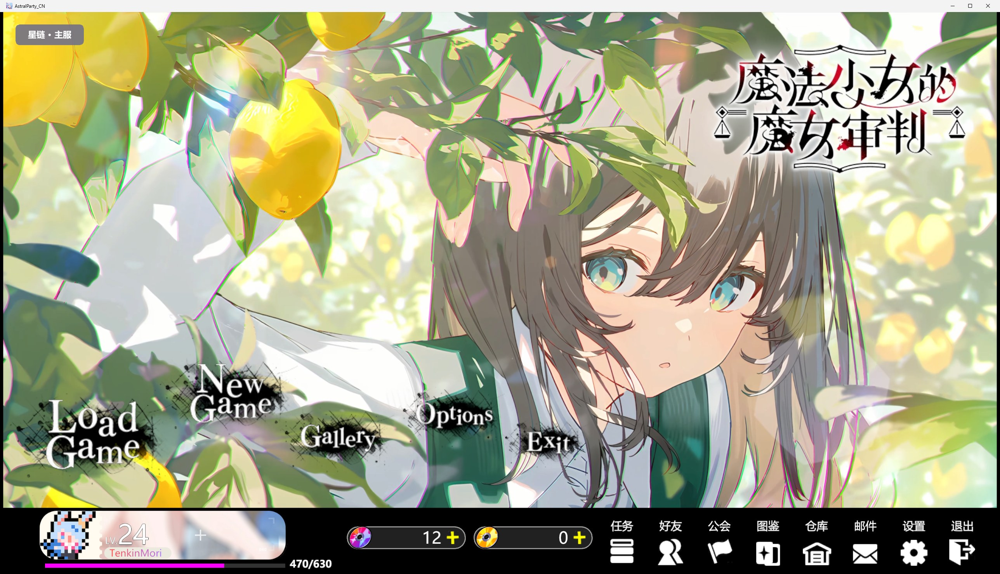

# 魔裁主题首页 / MagicalGirl WitchTrials Theme

把《吉星派对》主页改造成《魔法少女的魔女审判》风格主菜单的 **CesiumLoader 托管模组**。

- 模组 id：`WitchTrialsTheme`
- 中文名：魔裁主题首页
- 运行时只操作 FairyGUI 控件，**不改任何游戏文件 / bundle**，游戏更新不会把它覆盖掉。



## 效果

| 官方控件 | 变成 |
| --- | --- |
| `btn_GameOnline`（开始游戏） | **Load Game** @ (18, 702) 378×232 |
| `btn_Dictionary`（角色） | **New Game** @ (320, 664) 267×202 |
| `btn_Mall`（商店） | **Gallery** @ (570, 754) 222×149 |
| `btn_Gacha`（抽奖） | **Options** @ (788, 709) 206×157 |
| `btn_Activity`（活动） | **Exit** @ (964, 763) 189×182（接管为「退出游戏」） |
| `btn_PlayerGuide`（装扮） | 右上角 LOGO @ (1340, 24) 556×326（点击仍开装扮） |

- 每个按钮都有常态（`al_*_dark.png`）与按下态（`al_*_pink.png`）两张图，按下时切图，**关掉了官方内置的变暗 / 缩放动效**。
- 隐藏：`com_Banner`、`com_Activity`、`com_expand`、`com_ActivityBanner`、`com_BattlePass`、`Com_Tip`、`Btn_BGSet`、`Btn_Hide`、四个抖音按钮。
- 背景不在这里做 —— 请同时装 [HomeBackgroundMod](https://github.com/)（本模组只叠在背景之上，不抢 `Com_BGSet.loader_Video`）。

## 安装

1. 装好 CesiumLoader（`version.dll` 门代理 + `AstralParty_ModLoader/`）。
2. 把 `dist/WitchTrialsTheme/` 整个目录拷到：

   ```
   <游戏目录>/AstralParty_ModLoader/mods/WitchTrialsTheme/
   ```

   结构应为：

   ```
   WitchTrialsTheme/
     WitchTrialsTheme.dll
     WitchTrialsTheme.json
     icon.png
     assets/al_loadgame_dark.png … al_exit_pink.png
     assets/logo_cn_full.png
   ```

3. 启动游戏，进主页即生效。

## 配置

首次运行会在模组数据目录生成配置：

```json
{ "enable": true, "overrideExit": true }
```

- `enable`：总开关。
- `overrideExit`：是否把 **Exit** 槽位（`btn_Activity`）接管成「退出游戏」。
  官方每次 `HomePanel.Refresh()` 都会把这个按钮重写成"打开活动中心"，没有活动数据时还会直接隐藏；
  模组每 0.25 秒幂等重放一次，把它抢回来。关掉此项则保留官方活动中心行为。

## 从源码构建

```powershell
./build.ps1
```

产物在 `dist/WitchTrialsTheme/`。需要：

- .NET SDK 8+（实测 9.0.305）
- `refs/game/AstralParty.Runtime.dll`、`UnityEngine.CoreModule.dll`、`UniTask.dll`
- `lib/CesiumLoader.SDK.dll`

## 实现要点

- **定位面板**：`SimpleSingletonProvider<UIManager>.inst.currentPanel` → `UIPanelType.Home` → `HomePanel.UIObject`（`UIHomePanel`）。
- **换美术**：把官方按钮的子控件 `visible=false / alpha=0`（它们带 `GearDisplay`，所以每轮重压），
  末尾 `AddChild(new GLoader{ fill = FillType.ScaleFree, touchable = false })` 叠我们自己的图。
  命中测试不看 alpha，原按钮 `touchable` 保持 true，所以点击逻辑完全照旧。
- **LOGO**：`btn_PlayerGuide` 从右下角 150×150 拉成右上 556×326，并压掉官方立绘。
- **Cut in 转场**：`Transition._items[].tweenConfig.endValue`（`TValue.f1/f2`）用反射改成我们的落点 ——
  这个包的 transition item 没有 label，`SetValue` / `SetHook` 都不可用。
- **按下态**：`GButton._downEffect`（private）反射置 0，避免官方把我们的图压暗；
  再监听 `button` 控制器 `onChanged`，在 `down` 页显示 pink 图。
- **PNG**：自带 `PngDecoder`（仅 8-bit 非隔行），逐行上下翻转后 `LoadRawTextureData` 进 `Texture2D`。

## 目录

```
src/WitchTrialsTheme/   模组源码 + assets
refs/game/              编译用游戏程序集
lib/                    CesiumLoader.SDK.dll
dist/WitchTrialsTheme/  构建产物（可直接安装）
build.ps1               一键构建
```

## 授权

MIT。
